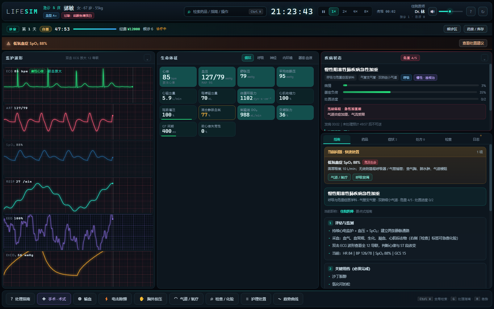
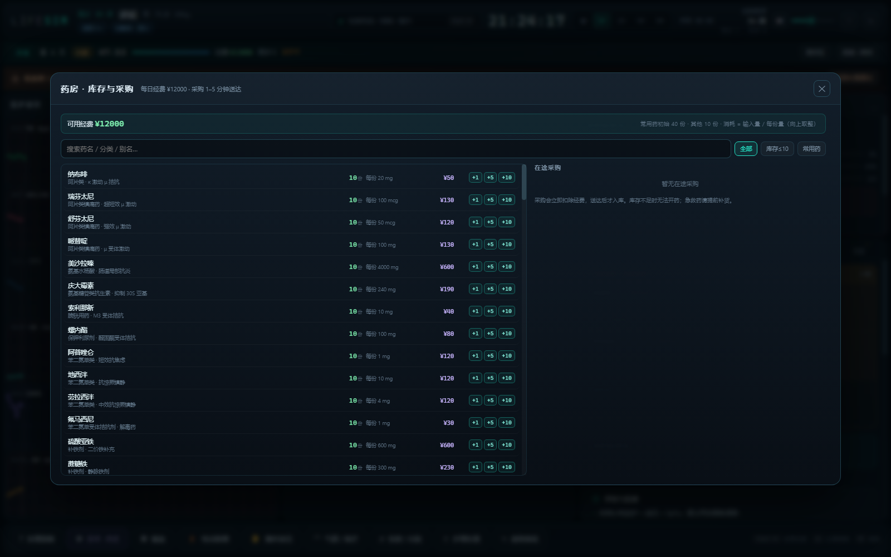
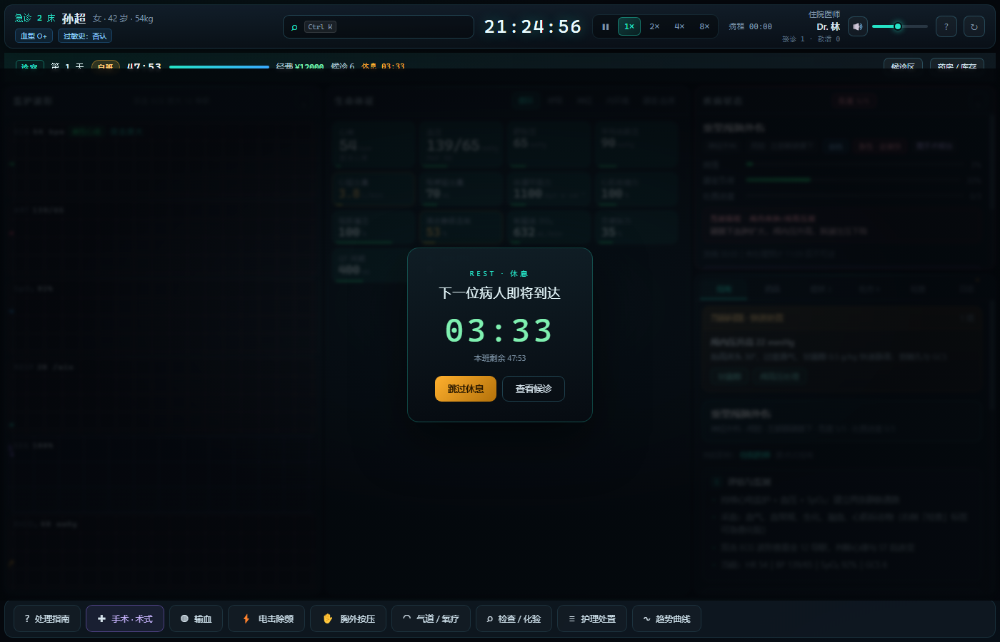
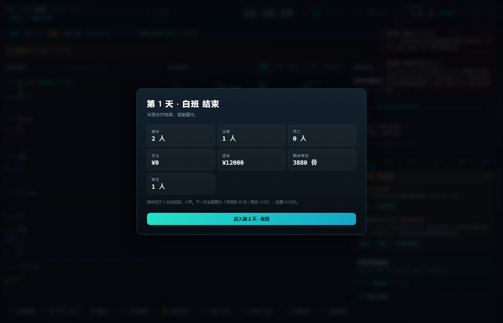
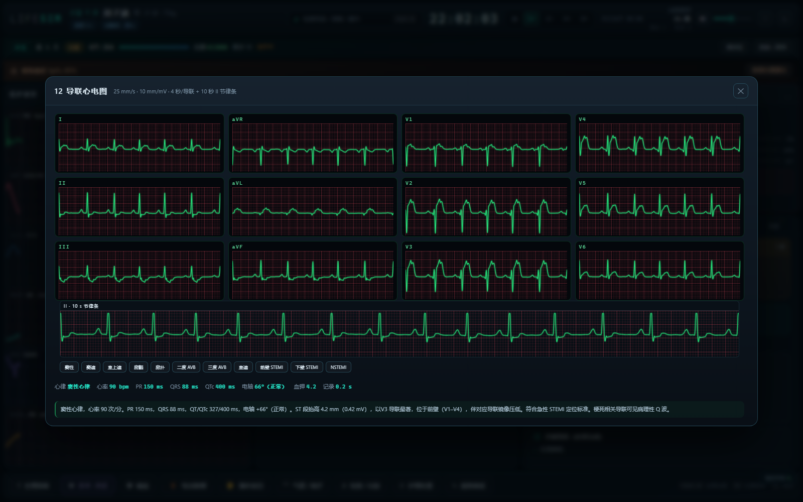
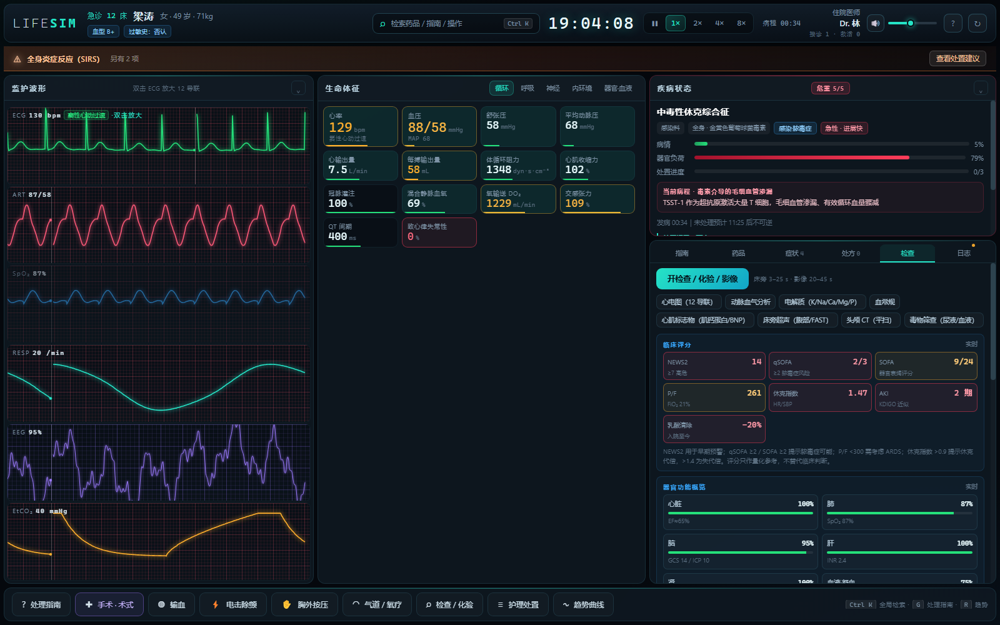
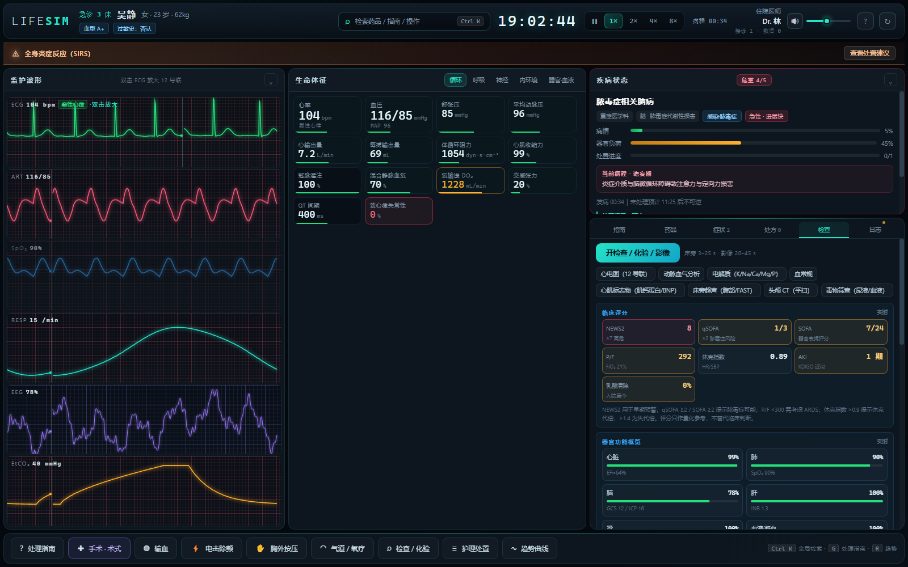
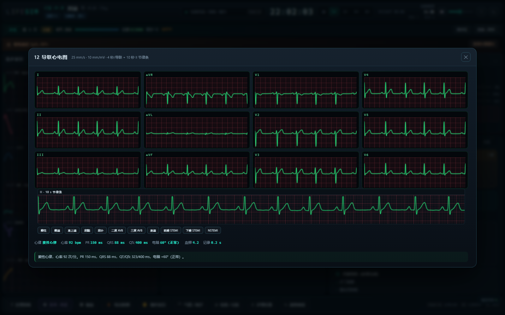
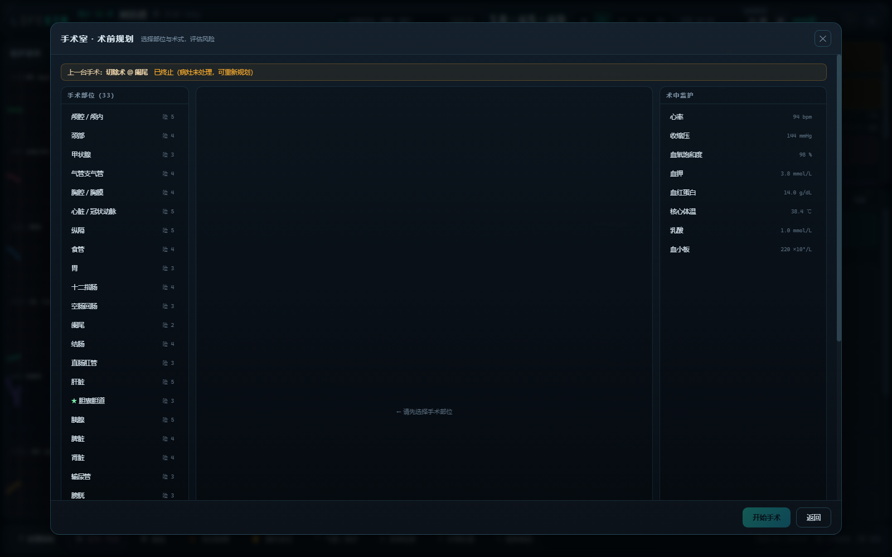

# LIFE SIM · 诊室模式 2.5

一个纯前端（零依赖、离线可跑）的**临床生命体征模拟器 / 医生扮演游戏**。

> 诊室模式详细规则（时间、库存、经费、采购、休息、清单与治愈）见 [诊室模式说明.md](诊室模式说明.md)。
模拟人体多器官耦合、药代-药效动力学、疾病进程、手术风险与输血反应。

---

## 诊室模式 · 白班 48 分钟 / 夜班 48 分钟

这是 **诊室 / 门诊模式** 副本；急诊室基础版在 `D:\新建文件夹\live 2.5`。

- **白班 48 分钟、夜班 48 分钟**，两个班次等长，交替进行（第 1 天白班、第 2 天夜班……）。
- 每位病人结束后 **休息 2–8 分钟**（旧版 0–4 分钟），并且**休息期间本班计时暂停**——48 分钟全是接诊时间。
- **白班**：候诊 10 人，大量普通病例 + 中暑/热射病；**夜班**：候诊 4 人，以急诊/危重为主。
- **病人类型一律随机**：诊室不再让玩家挑病例类型，只由职称决定难度。
- 每天 **¥12,000 经费**；**常用药 40 份、其他药 10 份、手术耗材 8 份**。
- 药品每次消耗 = **输入剂量 ÷ 每份包装量，向上取整**（肾上腺素 0.5 mg 静推 = 1 份，阿司匹林 300 mg = 3 份）；手术按「术式 + 部位」扣耗材。
- 库存不足时无法开药 / 无法开台；到「**药房 / 库存**」采购**药品与耗材**，**1–5 分钟送达**，送达后才入库。
- **清单做完 ≠ 病人好了**：完成所有必需处置后，若循环/氧合/体温/血钾仍不稳定，疾病不会回退，也不会转归；必须继续支持治疗并连续稳定 45 秒（慢性病 75 秒）。
- 每位病人结束后弹出结算报告；本班结束弹出 **日结算**（接诊 / 治愈 / 死亡 / 转交 / 支出 / 结余 / 库存 / **本班医誉**），点击进入下一天。
- **退出自动存档**：关掉页面时把本班进度（天数 / 班次 / 剩余时间 / 经费 / 库存 / 在途采购 / 战绩）写进账号，下次打开自动续上。



**药房 / 库存**：每份包装量、单价、库存、采购 1/5/10 份、在途配送倒计时。



**休息时间**：下一位病人到达倒计时，可跳过休息或查看候诊区。



**日结算**：接诊、治愈、死亡、转交、支出、结余、剩余库存；进入下一天自动切换白班 / 夜班。



### 医师账号 · 医誉等级

- **8 个等级**：见习医士 → 住院医师 → 主治医师 → 副主任医师 → 主任医师 → 学科带头人 → 院长 → 杏林国手。
- **福利**：药品/耗材 **0–20% 折扣**、配送提速 **5%–45%**、副主任医师及以上在白班高峰期**优先配送**（送达时长 ×0.55）。
- **医誉来源**：治愈 +10~18（按单例评分）、死亡 −6、全班结算另加全勤奖；按账号累计，升级立即生效。
- **保持账号**：登录时勾选，12 小时内再次打开直接进入、无需密码；不勾选则关闭浏览器后要重新登录。
- **跨版本账号追回**：自动扫描本机所有旧版存档（含旧键名）并合并；也可把「账号码」粘贴到另一台机器 / 另一个版本恢复。
- 账号、战绩与急诊室版共用同一份本机存档，两个版本互通。

### 手术耗材

- **14 种耗材**：无菌手术包、手套、缝线套件、吻合器、止血材料、引流管、冲洗与吸引、骨科钢板螺钉、骨水泥、胸腔引流套件、开颅套件、血管器械、内镜介入、麻醉气道。
- 在「**药房 → 手术耗材**」页签采购（1/3/5 份一键下单，医誉折扣同样适用）。
- 开台前自动核对术式所需：切除术要手术包 + 缝线 + 止血，吻合术要吻合器，固定术要钢板 + 骨水泥，颅脑要开颅套件，胸腔要胸腔闭式引流套件；**缺任何一项都无法开台**并列出缺项。

### 12 导联心电图（v2.5 重写）
- **肢体导联改由心电向量投影**：先定额面心电向量，再投影出 I / II / III / aVR / aVL / aVF，
  Einthoven 定律（I + III = II）与 aVR = −(I + II)/2 自动成立，电轴由波形本身算出来。
- **按 R 波时刻表合成心搏**：P 波画在下一个 R 波之前（旧版把 P 画在 R 之后，实际从未显示），
  12 个导联共用同一份时刻表，12 导联真正同步，房颤的 RR 也逐搏一致。
- **纸速与增益有标定**：25 mm/s、10 mm/mV，1 mm 网格 = 40 ms / 0.1 mV，PR / QRS / QT 可在格子上读数。
- **形态按健康人参考值**：P ≤ 2.5 mm、R 波 V1→V5 递增、V2 的 S 最深、V1 与 aVR 的 T 波倒置、
  T 波上升慢下降快，QRS 之后留有等电位 ST 段；缺血按区域给出 ST 抬高 + 镜像压低 + 病理性 Q。
- 底部附 **10 秒 II 导联节律条**；每 450 ms 重绘；关闭弹窗清理缓存。
- **心脏停搏 / 室颤时不再显示假心率**：心率 0 bpm（无电活动 / 无有效心搏），各间期与电轴显示「—」。
- 单导联监护仪仍为扫描式实时描记。
- 12 导联底部提供心律预设：窦性、窦速、室上速、房颤、房扑、二度/三度 AVB、室速、前壁/下壁 STEMI、NSTEMI。
- 右下角「相互作用」徽标实时扫描 QT 叠加、出血、5-HT、镇静/呼吸抑制、房室传导、肾毒性、高钾。


前壁 STEMI：V1–V4 的 ST 段抬高（V3 最著）与 II / III / aVF 的镜像压低；下方 II 导联节律条为同一时刻采样。



---

## 界面截图（基础界面）

**检查中心**：床旁检验 / 实验室 / 影像 / 穿刺一键开单（**47 个检查项目**，同时最多 10 项并行），右侧实时显示器官功能、器官相互作用与问题定位。



**临床评分**：NEWS2 / qSOFA / SOFA / P-F 比 / 休克指数 / KDIGO AKI 分期 / 乳酸清除率，随生理状态实时更新。



**12 导联心电图**：区域性 ST 抬高 / 镜像压低、房扑/交界性/二度阻滞/尖端扭转型室速，底部自动测量 PR/QRS/QTc/电轴。



**手术室**：终止或完成一台手术后可以重新规划下一台（顶部显示上一台手术状态）。



---

## 启动方式

**双击 `index.html`** 即可（Chrome / Edge 均可，无需服务器、无需联网、无构建步骤）。

首次进入填写**医师姓名**（用于签署死亡证明），选择**职称**（= 难度，见下文）后点「开始接诊」。

---

## 界面说明

```
┌──────────────────────────────────────────────────────────────────────────┐
│ 病人/血型/过敏    ⌕ 检索药品·操作·体征 Ctrl K    时钟 倍速  医师 帮助   │
├──────────────┬──────────────────────────────┬────────────────────────────┤
│ 监护波形      │  生命体征                     │  ▣ 疾病状态（右上角·可折叠）│
│ ECG II        │  [循环][呼吸][神经]           ├────────────────────────────┤
│ 动脉压 ART    │  [内环境][器官·血液]          │ 药品│症状│处方│检查│日志  │
│ SpO₂ 脉搏波   │   ← 一次只看一组              │  ↑ 药品库在这里            │
│ 呼吸 RESP     │                               │  按功能大类折叠分组        │
│ 脑电 EEG      │                               │  完整药名 + 单位 + 常用量   │
│ 呼末 CO₂      │                               │                            │
├──────────────┴──────────────────────────────┴────────────────────────────┤
│  手术室 · 输血 · 电击除颤 · 胸外按压 · 气道/氧疗 · 体格检查 · 护理处置     │
└──────────────────────────────────────────────────────────────────────────┘
```

### 药品库（右侧「药品」标签）

- **按功能大类分组**（急救复苏 / 镇静镇痛麻醉 / 心血管 / 抗感染 / 液体治疗 / 内分泌代谢 / 血液 / 消化 / 神经精神 / 呼吸 / 解毒剂…），每组显示条数，点分组标题展开/收起，默认展开第一组。
- **列表形式显示完整药名**（不截断、可换行），下方一行给出「分类 · 途径数 · 常用剂量」，右侧标出计量单位。
- 顶部搜索框支持 **药名 / 别名 / 分类 / 途径 / 靶点**（如「胺碘酮」「升压」「血钾」「口服」），搜索时自动展开全部命中分组。
- 已开过的药会带绿色边框，方便复用。高危药（红点）、管制药（紫点）、有过敏风险（黄点）都有标记。

### 降低信息密度的设计

1. **生命体征分组标签** —— 30 项指标按「循环 / 呼吸 / 神经 / 内环境 / 器官·血液」分组，点标签切换。
2. **右侧标签分区** —— 药品、症状、处方、检查、日志合并为一个标签区，一次只显示一个；有新日志时标签会亮起提示点。
3. **可折叠面板** —— 监护波形列（收起成竖条，把空间让给数字与弹窗）、疾病状态都可以点标题右侧的 `⌄` 折叠。
4. **底部只剩一条操作条** —— 原来占 212px 的药品库移入右侧标签后，中间区域明显变高。

### 全局检索（命令面板）

点顶栏的检索框或按 **`Ctrl + K`**（macOS 为 `⌘ + K`）打开：

- 输入 **药名 / 别名 / 分类 / 靶点**（如「胺碘酮」「升压」「血钾」「k」）→ 回车直接打开给药面板
- 输入 **操作**（「手术」「输血」「除颤」「CPR」「插管」「化验」「暂停」）→ 回车直接执行
- 输入 **体征分组**（「循环」「神经」）→ 回车跳到对应分组
- `↑` `↓` 选择，`Enter` 执行，`Esc` 关闭

**双击 ECG 波形** → 弹出**全 12 导联心电图**（I、II、III、aVR、aVL、aVF、V1–V6），实时刷新。

---

## 职称 = 难度

开局不选「难度档位」，而是选**职称** —— 职称同时决定你能得到多少帮助、以及病人有多凶险。所有参数都写进 [engine.js](js/engine.js) 的 `M.DOCTOR_RANKS`：

| 职称 | 病例指南 | 术中并发症 | 病程进展 | 剂量提示 | 病人来源 |
|---|---|---|---|---|---|
| **实习医师** | 完整分步（含药名、剂量、术式） | ×0.75 | ×0.85 | 全开（推荐量 + 过量阈值） | 不含 5 级危重 |
| **住院医师** | 要点式（药名 / 术式，无剂量备注） | ×1.0 | ×1.0 | 全开 | 全部 |
| **主治医师** | 只给方向（需要几项处置、是否需手术） | ×1.2 | ×1.15 | 关闭 | 危重度 ≥ 2 |
| **主任医师** | 完全不给提示 | ×1.4 | ×1.3 | 关闭 | 危重度 ≥ 3 |

「剂量提示」关闭时，给药面板不再显示推荐区间与过量阈值线，只能靠通用指南里的「急救药物速查」和自己的判断。

**医师档案**：接诊数、救活数、死亡数、存活率、累计评分、最佳单例评分，保存在本机浏览器（localStorage），换职称不影响历史战绩。顶栏右上角实时显示，指南弹窗的「医师档案」标签里有完整说明。

---

## 处理指南

按 **`G`** 或点操作条第一个按钮「处理指南」，弹窗分三个标签：

**① 当前病例** —— 按你的职称给不同详细程度的分步方案：

- STEP 1 评估与监测（含当前 HR/BP/SpO₂/GCS 实时值）
- STEP 2 关键用药（必须完成项，做完会打 ✓）
- STEP 3 关键手术（术式 @ 部位）
- STEP 4 可选辅助处置
- STEP 5 监测目标
- STEP 6 **病程进展时间轴** —— 每个阶段会在第几分钟出现、哪一阶段致命、当前处在哪
- ⚠ 避免以下处置（本病例的错误用药及后果）

**② 临床指南手册** —— 14 篇通用流程，可搜索（标题、标签、正文全文检索）：

`ABCDE 五步法` · `心跳骤停/ACLS` · `心律失常处理` · `急性冠脉综合征` · `休克识别与复苏` · `脓毒症 1 小时集束化` · `呼吸衰竭与气道管理` · `创伤初级评估` · `中毒处理原则` · `电解质与代谢急症` · `输血与溶血反应` · `术中并发症处理原则` · `急救药物速查` · `复苏后管理`

**③ 医师档案** —— 当前职称的能力说明与本机战绩。

右侧标签区也有一个「**指南**」标签，随时显示当前病例的精简版指南，不必开弹窗。

> 全局检索（`Ctrl K`）也能搜指南：输入「休克」「高钾」「输血反应」会直接打开手册并定位到该篇。

---

## 核心机制

### 生理引擎
- 每秒 60 帧推进，速度可 0 / 1× / 2× / 4× / 8×（空格暂停，数字键调速）。
- 数值合成层次：**健康基线 + 疾病偏移 + 器官漂移 + 药物效应 + 事件扰动 + 呼吸/循环支持**。
- 器官耦合：心输出量由心率 × 每搏量推导，血压再受容量、外周阻力、心输出量三重修正；
  MAP 下降 → 肾灌注不足 → 少尿、肾功能恶化、血钾升高；SpO₂ 下降 → 脑电活动与 GCS 下降 → 呼吸驱动减弱 → 进一步缺氧，形成真实的恶性循环。

### 心电图（v1.6 重写）
- **间期随心率与内环境变化**：PR 随房室传导延长，QRS 随血钾 / 酸中毒 / 低体温增宽，QT 用 Bazett 公式随 RR 缩短（QTc 才是药物与电解质效应的指标）。
- **15 种心律**：窦性、窦缓、窦速、房颤、**房扑**、室上速、室速、**尖端扭转型室速**、室颤、心脏停搏、无脉电活动、三度阻滞、**二度阻滞**、**交界性心律**、濒死心律。
- **导联区域性缺血**：按病例的 `ecgRegion`（前壁 / 下壁 / 侧壁 / 后壁 / 心包 / 右心）在对应导联抬高 ST 并产生镜像压低，缺血加重时 T 波倒置；V1–V6 保留正常 R 波递增。
- **电解质与体温**：高钾时 P 波变平、T 波高尖、QRS 增宽，＞8.4 呈正弦波；低钾出现 U 波；低钙 QT 延长；低体温出现 Osborne J 波与寒战伪差。
- **真实显示细节**：心房扑动为 300 次/分锯齿状 F 波（多为 2:1 传导），二度阻滞有 P 波后 QRS 脱落，三度阻滞 P 与 QRS 完全脱节，室速可见夺获/融合波，频发室早每 5 搏插入宽大畸形搏动。
- **机械与仪器伪差**：胸外按压时叠加 110 次/分按压伪差；除颤放电有尖峰与衰减噪声；除颤成功后先有约 1.2 秒电静息；室颤振幅随时间衰减（粗颤→细颤）。
- 双击 ECG 打开 12 导联，底部实时显示 **PR / QRS / QTc / 电轴**，并给出中文判读（ST 抬高导联、T 波改变、阻滞类型等）。

### 体液总量 / 胃内容量 / 放血（体液模型）

- **体液总量**（原「循环血量」）超过 **12 L** → **容量性心脏停搏**；容量降下来之前，**CPR / 除颤 / 肾上腺素都救不回来**。
- 新操作 **放血 / 血液置换**（操作台「放血」或快捷键 <kbd>B</kbd>）：自定速率 **0–500 mL/min**、目标剩余量 **0–5 L**，到量自动停；放血会同时带走血红蛋白、血小板与凝血因子。
- **血液稀释**：输入液体越多，Hb / 血小板 / 凝血因子被稀释得越明显（体液回到 5 L 后自动恢复）。
- **口服药物计入胃内容量**：≥ **10 L** 会胃扩张 → 迷走性心脏停搏，必须**手术（胃 → 洗胃 / 胃内容物清除）**把内容物抽出来才能复苏；胃内容越多，口服药吸收越快。
- **天文数字剂量有后果**：一次注入 ≥ 12 L 液体（例如 99999999 mL）会立即触发容量性心脏停搏，不再出现「打了这么多还活着」。

### 药理
- 每种药有真实 **单位 / 可用给药途径 / 剂量区间 / 半衰期 / 起效-达峰-维持时间**。
- 药代动力学：一室模型 + 吸收常数，`iv` 速效、`po` 生物利用度低、`iv_inf` 滴注达稳态后停药按半衰期衰减。
- 药效动力学：Hill 方程 `Emax·C^h/(EC50^h+C^h)`，累加到各生理靶点；受体类药效应会饱和，
  而**电解质/容量这类「负荷型」药物走线性模型**（`linear: true`），剂量翻倍效应就翻倍，大剂量必然中毒。
- **肝肾功能下降会延长药物半衰期**（代谢减慢，易蓄积中毒）。
- **药物过量**：超过常用上限 × 毒性系数后叠加毒性效应。
- **药物过敏**：按药物过敏概率触发，若患者已有该药过敏史，概率 ×4，直接诱发过敏性休克。
- 给药途径：口服 / 舌下 / 静推 / 静脉滴注 / 肌注 / 皮下 / 骨髓腔 / 吸入 / 雾化 / 直肠 / 外用 / 鼻饲（每种药只开放它真实存在的途径）。
- **起效时间**：每一条医嘱都有明确的起效延迟，不是「点完就生效」——
  静推约 2–8 秒（致死量级 1.5–3 秒）、肌注/皮下 20–300 秒、口服/直肠 60–900 秒、雾化 3–30 秒；
  处方列表会标注「起效中 / 作用中 / 已代谢」。
- **可能不起效**：① 触发药物过敏时，这一针的治疗作用直接被判为**未起效**（`failed`），只留下过敏反应；
  ② 低灌注状态下药物分布打折扣（MAP 越低，iv 只剩 55%、肌注/口服只剩 25% 左右的效果），
  给药日志会提示「当前低灌注，可能起效不完全」。

### 药物过量与靶器官损伤
- 每种药都有**靶器官**（心脏 / 肺 / 中枢 / 肝 / 肾 / 血液 / 胃肠），给药面板里直接标出来。
- 超过「常用上限 × 毒性系数」后进入中毒，按**剂量倍数**对靶器官造成进行性损伤，
  而不是简单地把效果封顶：
  - 心脏毒性：收缩力下降、致心律失常性升高、心率减慢；
  - 肺毒性：气道通畅度下降、氧合恶化；
  - 中枢：GCS 下降、呼吸抑制；肝 / 肾 / 血液 / 胃肠各自进行性恶化。
- **血药浓度没有上限**：浓度按「输入剂量 ÷ 常用量」线性增长（去甲肾上腺素 16/64/480/3000/30000 mcg
  → 峰值浓度 4×/15×/115×/716×/7159×，毒性倍数 1.3×/5.1×/38.5×/238×/2386×），不存在饱和封顶。
- **高浓度先「飙血压」后崩落**：受体饱和只会让血压停在 210/120 附近，但浓度继续升高会叠加
  **心肌抑制 + 血管麻痹 + 乳酸升高**，血压随即从峰值掉到测不出。
- **致死通道是确定性的**（不再靠小概率摇骰子）：
  - 毒性 ≥ **8×** 阈值 → 恶性心律失常（室颤）；
  - 毒性 ≥ **25×** 阈值 → 药物中毒性心脏停搏；
  - 浓度未降到 2× 以下之前，**CPR / 除颤 / 肾上腺素都无法恢复自主循环**，电击会直接提示「血药浓度过高」。
- 实测：去甲肾上腺素 3000 mcg（≈750 倍常用量）→ 血压 197 → 数秒内停搏 → 242 秒死亡，
  死因写明「药物中毒（去甲肾上腺素 血药浓度 1264× 毒性阈值）」；同剂量 3 L 生理盐水只扩容、不致死（对照）。
- 处方列表每条记录都会显示 **峰值浓度 X×·毒性 Y×**，超过阈值标红。
- 大量输液 / 输血过快会容量过负荷 → 肺水肿（氧合下降、湿啰音）。

### 高钾血症（可直接致死）
- 血钾 > 5.5：T 波高尖、心肌易激；> 6.5：房室传导抑制、心率与收缩力下降；
  > 7.0：随时蜕变为室颤；> 8.0：随时心脏停搏；**≥ 10：心肌电活动消失（心电直线）**。
- 氯化钾**开放了「静推」途径用于教学**：一旦静推，界面会给出绝对禁忌警告，1~2 秒后血钾冲顶、心电直线。
- 停钾 + 葡萄糖酸钙（稳定心肌膜）+ 胰岛素/葡萄糖 + 碳酸氢钠（把钾赶回细胞内）是唯一的挽回手段；
  只要 4 分钟抢救窗口内把血钾拉回 6 以下并持续 CPR，仍有机会 ROSC。

### 疾病：急性 vs 慢性
- 每个病例带 `course` 标记：
  - **急性**（大多数急诊病例）：进展 ×1.15，不处理容易迅速恶化甚至死亡。
  - **慢性**（COPD 急性加重 / 急性左心衰 / 肝硬化曲张出血 / DKA / 甲亢危象 / 高血压脑出血）：
    进展 ×0.65，但**缓解后只回退 65%**，留下不可根治的底子；稳定窗口 45 → **75 秒**；
    结算为「病情缓解」，需长期随访与维持治疗。
- 疾病面板会显示 **急性 · 进展快 / 慢性 · 难根治** 徽标。

### 疾病（86 例，含 26 例心脏骤停 / 创伤 / 中毒新病例）
- 每位病人**随机发病、随机既往史、随机社会史（长期酗酒 / 长期服用精神类药物 / 抗凝 / 药物滥用 …）**。
- 疾病分 3–5 个病程阶段，按时间自动推进并恶化，直至不可逆。
- 数值合成是「健康基线 **+** 疾病偏移 + 器官漂移 + 药物效应 + 事件扰动」，
  偏移量一律按增量累加（不会再出现把健康基线重复算一遍导致血压 300 / 体温 43℃ 的情况）。
- **器官互相影响**（多器官耦合，不只是单点数值）：
  肝功能 < 45% → 凝血因子合成下降（INR↑、clotting↓）、肝性低血糖、肝性脑病；
  肾功能 < 30% → 排钾排酸障碍（K⁺↑、pH↓）、尿毒症脑病、少尿；
  凝血 < 35% → 自发性出血（皮肤瘀斑、穿刺点渗血，可持续活动性出血）；
  颅内压 > 25 mmHg → 库欣反应（血压升高 + 心率减慢，脑疝前兆）；
  心功能 < 45% → 肝淤血 + 肾灌注下降；Hb < 7 → 组织缺氧、乳酸升高；胃肠功能 < 40% → 呕吐、第三间隙丢失。
- 含化验与影像（血气、生化、血常规、**降钙素原 PCT**、床旁超声、胸片、心电图）辅助诊断。

### 转归判定（抢救成功）
- 有「必需处置」的病例：全部完成**且循环/氧合达到可恢复条件**后，疾病才开始回退并进入观察期。
- 没有必需项的病例（DIC、CO 中毒、热射病、镇静药过量…）：完成**至少 2 项**对症处置，并维持体征稳定，才进入观察期。
- **清单做完 ≠ 病人好了**：即使所有必需处置都完成，只要循环/氧合/体温/血钾仍不稳定，疾病偏移就不会回退，也不会转归；必须继续支持治疗，直到连续稳定达标。
- 观察期内需**连续稳定 45 秒**（慢性病 75 秒）：平均动脉压 > 65、SpO₂ > 90%、乳酸 < 2.8、体温 34.8–39.0℃、
  血钾 3.1–5.8、血红蛋白 > 7，且有脉搏。中途恶化超过 2.5 秒则计时清零。
- 疾病面板会实时显示「稳定计时 xx/45 s」进度条，达标即弹出转归报告与评分。

### 术后并发症与术中所见
- 手术结束时会掷一次**术中所见**（粘连 / 脓性渗出 / 可疑肿瘤 / 肝硬化 / 肠管缺血 / 陈旧积血），
  写入日志并留下持续影响。
- 随后 **1–3 项术后并发症**在数分钟内陆续出现：术后出血、吻合口漏、切口感染、肺不张/肺部感染、
  肠麻痹、急性肾损伤、术后房颤、术后谵妄、下肢深静脉血栓、恶性高热。
- 每一项都会进入顶部问题条与指南清单，带处理要点和一键处置按钮。
- **并发症的解决方法不再"找不到"**：
  - 手术室（术前规划页 + 术中页）顶部固定显示「⚠ 需处理的并发症」卡片：显示当前所有术后问题、
    处理要点，以及可直接点的处置按钮（输血 / 具体药物 / 再次手术 / 气道 / 护理）。
  - 「再次手术」按钮会**自动选好原手术部位和合适术式**（出血→结扎止血，漏→缝合/引流/造口），
    开台即视为已处理。
  - **做对其中任何一项处置，问题就自动销账**，并发症带来的持续负担同时撤掉，不会出现
    「处理了也不消失」。
  - **术中并发症没处理完手术就结束/终止**时，不再悄悄消失：按并发症影响的系统给出血/循环/气道
    后果，并转成一条带处理方法的术后问题。

### 手术
- **手术时长已大幅压缩**：小操作（结扎 / 活检 / 冲洗）约 1.5 分钟，常规术式 2–4 分钟，
  吻合 / 置换等大手术 5–6 分钟；术中并发症发生率同步下调，一台手术通常遇到 0–2 次并发症。
- **33 个手术部位 × 18 种术式**（切除、引流、缝合修补、吻合、造口、清创、减压、结扎止血、固定、置换移植、活检、探查、栓塞介入、内镜、冲洗、复位、分流、摘除），每个部位只开放解剖学合理的术式。
- 手术分阶段推进（每术式 6 个步骤），术中有**出血、心律失常、心跳骤停、过敏、恶性高热、误伤邻近器官、气栓、迷走反射**等 40 种并发症。
- 并发症弹出后须在**限定时限内**从 5 个选项里挑出正确处置；错误或超时都会加重病情，甚至直接诱发室颤。
- 术中可随时**给药 / 加快进度 / 终止手术**。
- **终止或完成手术后可以重新规划下一台手术**（旧手术会记入 `surgeryHistory`，术前规划页会显示「上一台手术：已终止 / 已完成」）。这是 v1.6 修复的关键 bug：旧版把已完成/已终止的手术一直留在 `sim.surgery`，导致再也开不了新台。

### 输血与溶血
- 每位患者有 **ABO + Rh 血型**、长期抗凝状态。
- 可选浓缩红细胞 / 全血 / 新鲜冰冻血浆 / 血小板 / 白蛋白，可先做**交叉配血试验**。
- 血型不合（含 Rh 不合、血浆反向不合）→ **急性溶血性输血反应**：血红蛋白骤降、高钾、DIC、急性肾衰、休克，50% 概率直接室颤。

### 死亡判定
- 一旦无脉搏即开始倒计时，**满 4 分钟**自动宣告死亡（顶部显示 CPR 倒计时条）。
  - 致死剂量推注（如大剂量氯化钾静推）会有 **1~2 秒起效延迟**，随后心率骤降、心电直线、脉搏消失，
    再进入 240 秒抢救倒计时；4 分钟内没能恢复自主循环即宣告死亡。
- 死亡时间**读取电脑当前时间**，生成死亡记录 / 死亡证明，并需**签署医师姓名**（可修改）。
- 结算弹窗**优先级最高**：即使当时正开着用药 / 指南 / 手术弹窗，也会强制切到死亡记录或转归报告，
  不会出现「病人已经死了/已经抢救成功，但界面没反应」的情况。
- 抢救成功同样生成转归报告与综合评分。

### 心律与波形
- 除窦性 / 房颤 / 室速 / 室颤 / 心脏停搏外，新增**无脉性电活动（PEA）**：心电上有宽大畸形的
  缓慢 QRS（20–55 次/分），但动脉压与脉搏波是一条直线 —— 有电活动、没有机械收缩。
- **每一次心搏由多个器官共同决定**：心率随呼吸波动（窦性心律不齐）、P 波随容量增高、
  QRS 随血钾/酸中毒/体温增宽、T 波随血钾/血钙改变、低钾出现 U 波、收缩力差时出现电交替；
  房颤无 P 波、三度阻滞 P 波与 QRS 脱节。
- **波形是扫描式的**：光点固定在左侧起点、向右匀速扫描，笔尖到哪儿新波形就写到哪儿，
  走满一屏后回到左端继续覆盖旧波形（旧波形留在原位不动，不会整条左移）。
- **电击除颤**会在波形上产生真实的放电伪影（尖峰 + 衰减噪声）；
  除颤成功后心脏先有约 1.2 秒的**电静息（重启）**，然后才恢复窦性心律与脉搏。
- ECG 面板右上角新增**心律徽标**：实时显示当前心律，室颤/停搏红色闪烁，PEA 紫色，无脉时追加「· 无脉」。

### 难度与「人祸」
- 整体恶化速度、转归门槛、药物过量致死门槛、术中并发症频率都已上调一档。
- **乱点会出事**：4 秒内反复点同一操作（或狂点 8 次以上）可能触发误放电、拿错药、扯脱管路、
  按压手法错误、气管插管误入食管 —— 其中误放电有 55% 概率直接诱发室颤。
- **无指征操作有代价**：有脉搏时电击 → 35% 概率 R-on-T 室颤；有脉搏时按压 → 心肌挫伤 + 肋骨骨折风险；
  直线时反复电击 → 加重心肌损伤。

### 当前问题与快速处置
- 顶部**问题条**实时显示最紧急的问题；右侧「指南」标签里是一份按严重度排序的**问题清单**：
  每个问题都给出处理要点 + 一键处置按钮（去电击 / 开始按压 / 开某种药 / 开气道 / 输血 / 回手术室……）。
- 新出现的问题会弹提示并写入事件日志（同一问题 30 秒内只提醒一次）：室颤、心脏停搏、PEA、休克、
  高/低钾、酸中毒、高/低血糖、低氧、高热/低体温、贫血、凝血障碍、颅高压、癫痫、过敏、少尿、术中并发症……
- 高钙危象需要的**降钙素（鲑鱼降钙素）**与**唑来膦酸**已经补进药品库。

### 趋势曲线
- 底部操作条「趋势曲线」按钮或 <kbd>R</kbd> 键：生命体征趋势图，5 条通道
  （心率 / 收缩压 / SpO₂ / 体温 / 血钾），背景绿色带为正常参考区间。
- 图上叠加**事件标记**：⚡ 电击除颤、✚ 胸外按压，方便复盘「什么时候除的颤、按压了多久」。
- 每 2 秒采样一次，展示最近 10 分钟。

### 音效
- 全部由 Web Audio 实时合成，**不依赖任何音频文件**，离线可用，首次点击「开始接诊」后启用。
- **心搏提示音**：跟随当前心率「嘀」声（心率越快音调略高）；没有脉搏时自然静音。
- **报警音**（按优先级）：室颤、心脏停搏、无脉性电活动（PEA）、SpO₂ 低（<90 / <85 更急）、
  心率过缓/过速、收缩压 < 90。
- **事件音**：电击放电、ROSC（自主循环恢复）、抢救成功上扬音阶、死亡下坠音。
- 顶栏右侧有**音量滑块 + 静音按钮**，音量会记住（localStorage）。

---

## 快捷键

| 键 | 功能 | 键 | 功能 |
|---|---|---|---|
| `Ctrl/⌘ + K` | 打开全局检索 | `空格` | 暂停 / 继续 |
| `G` | 处理指南（当前病例 + 手册） | `1` `2` `4` `8` | 切换倍速 |
| `E` | 检查 / 化验 | `C` | 开始 / 停止胸外按压 |
| `S` | 手术室 | `F` | 电击 / 除颤 |
| `R` | 趋势曲线 | `D` / `X` / `Y` | 药品 / 处方 / 症状 |
| `T` | 输血 | `A` | 气道与氧疗 |
| `D` | 切到「药品」标签 | `X` | 切到「处方」标签 |
| `Y` | 切到「症状」标签 | `Esc` | 关闭弹窗 / 检索 |

---

## 文件结构

```
index.html            页面骨架与脚本加载顺序
css/app.css           深色医学监护主题样式
js/data-drugs.js      药品库主表
js/data-drugs2.js     药品库补充（液体复苏 / 电解质 / 常用药）
js/data-drugs3.js     药品库补遗（尼莫地平 / 丙硫氧嘧啶 / 哌拉西林他唑巴坦 + 25 种急救与常规药物）
js/data-drugs4.js     急救 / 解毒 / 抗微生物 / 心血管补充药（47 种）
js/data-drugs5.js     常规 / 慢病 / 精神 / 呼吸 / 消化 / 泌尿药（49 种）
js/data-diseases.js   疾病库主表（60 种，含病程阶段与标准处置）
js/data-diseases2.js  新增 26 例：心脏骤停 / 创伤 / 中毒 / 环境 / 妇产 / 脓毒症
js/data-exams 相关     检查项目与报告生成在 js/exam.js
js/data-surgery.js    手术库（33 部位 / 18 术式 / 40 并发症）
js/data-guide.js      临床处理指南（14 篇通用流程手册）
js/engine.js          生理引擎、药理动力学、疾病进程、手术、输血、死亡判定、职称参数
js/ecg.js             波形合成与绘制（12 导联 / 区域性 ST / 15 种心律 / 心率校正间期）
js/exam.js            检查系统（47 个项目 / 待回报队列 / 器官功能概览 / 问题定位）
js/audio.js           监护仪音效（心搏提示音 / 各类报警 / 除颤与转归提示音，Web Audio 实时合成）
js/ui.js              面板渲染、药品库、12 导联、手术台、输血、死亡证明
js/main.js            启动流程、主循环、速度控制、事件消费
js/data-stock.js      诊室模式：常用药 / 每份包装量 / 单价 / 初始库存 / 手术耗材 / 医誉等级
js/clinic.js          诊室模式：白班/夜班 48 分钟、休息（计时暂停）、药品+耗材库存、采购配送、手术耗材核对、候诊、日结算、进度存档
js/account.js         医师账号 / 医誉等级与福利 / 12 小时免密 / 跨版本账号追回
css/clinic.css        诊室模式：状态条 / 药房 / 休息 / 日结算样式
```

> 全部为传统 `<script>` 脚本（非 ES module），因此可以直接以 `file://` 打开，不需要本地服务器。

---

# v1.6 更新（第八轮）：检查中心 · 新病人类型 · 器官互作 · 心电升级 · 药品扩容

## 1. 手术「终止后不能再开台」——已修

- **现象**：术中点「终止手术」后，再点手术室仍然只看到「手术进行中」，无法重新选部位/术式；手术正常做完后同样不能再开第二台。
- **根因**：`cancelSurgery()` 只把 `active` 置为 false，`sim.surgery` 一直保留；而 `UI.openSurgery()` 用 `if (!sim.surgery)` 判断是否显示规划页，`startSurgery()` 也用 `if (sim.surgery)` 拒绝新手术。
- **修法**：
  - 新增 `archiveSurgery()`：把完成/终止的手术写入 `sim.surgeryHistory`（含术式、部位、状态、历时），最多保留 20 台；
  - `openSurgery()` 改为只有 `sim.surgery.active` 才显示术中界面；规划页顶部显示「上一台手术：已终止 / 已完成」；
  - `startSurgery()` 只有在**正在进行的**手术存在时才拒绝，旧手术自动归档。
- 自动化验证：终止 → 再次开台 → 加速做完 → 第三次开台，全部成功，`surgeryHistory` 记录 2 台以上。

## 2. 「检查」成为独立系统（33 个项目）

右侧新增/重做「**检查**」标签，不再只是结果留档，而是一个可以开单、等回报、看器官功能的诊断中心：

| 分组 | 项目 | 回报时间 |
|---|---|---|
| 床旁即时 | 心电图、末梢血糖、动脉血气、电解质（K/Na/Ca/Mg/P）、乳酸、血常规、凝血、心肌标志物、肾功能、肝功能、胰酶、感染指标、血酮/渗透压、尿常规、妊娠试验 | 3–25 s |
| 实验室 | 毒物筛查、COHb、MetHb、胆碱酯酶、对乙酰氨基酚浓度、渗透压间隙、血型、交叉配血、血培养 | 8–40 s |
| 影像 | 床旁胸片、腹部/FAST 超声、超声心动图、头颅 CT、腹部 CT、胸部 CT | 20–40 s |
| 特殊操作 | 腰椎穿刺、急诊胃镜、床旁支气管镜 | 30–40 s |

- **待回报队列**：同时最多 6 项，标签上实时倒计时；回报时写入日志，危急值立即弹窗。
- **器官功能概览**：心脏 / 肺 / 脑 / 肝 / 肾 / 血液·凝血 / 胃肠 / 免疫·炎症 8 个器官实时百分比与关键指标。
- **问题定位**：根据当前异常计算最可能受累的器官（如「肾 70% · 肺 21%」），并说明「这是器官层面排序，不是最终诊断」。
- **活跃的器官相互作用**：把当前正在发生的跨器官损伤列成可读的链条（见第 4 节）。
- **检查线索**：把阳性结果归纳成可执行的判断，例如「PCT > 2 → 脓毒症可能性大，1 小时内抗生素 + 培养 + 液体复苏」。
- 检查结果会区分**数值 / 定性**（阳性、阴性、血型、培养涂片、脑脊液外观），异常值带 ↑/↓/⚠ 标记与参考范围。

## 3. 更多病人类型：心脏骤停 / 创伤 / 中毒

- 疾病库 60 → **86 例**，新增 `js/data-diseases2.js` 26 例：
  - **心脏骤停 3**：院外室颤、PEA、复苏后综合征；
  - **创伤 7**：骨盆骨折大出血、连枷胸/肺挫伤、重型颅脑外伤、颈髓损伤/神经源性休克、挤压综合征/横纹肌溶解、创伤性心脏骤停、电击伤；
  - **中毒 10**：甲醇、乙二醇、氰化物、对乙酰氨基酚、三环类、百草枯、毒蛇咬伤、亚硝酸盐/高铁血红蛋白、毒蕈、地高辛；
  - **环境 2**：重度低体温、高原肺水肿；
  - **妇产 2**：子痫、羊水栓塞；
  - **感染 2**：中毒性休克综合征、脓毒症相关脑病。
- 开局新增「**接诊类型**」选择：随机 / 心脏骤停 / 创伤 / 中毒 / 心血管 / 呼吸 / 神经 / 消化·腹部 / 肾·内分泌 / 妇产 / 环境·理化 / 感染·脓毒症 / 血液。抽病例时按类型过滤，并保留职称的危重度门槛与性别排除。
- 新病例的 `category` 字段与 `M.CASE_CATEGORIES` 一一对应；旧 60 例通过 `CAT_MAP` 映射到同一套类型，界面显示类型徽标。
- 到院化验（`def.labs`）会同步进初始生理状态（hb 兼容 g/L），避免「化验单 K⁺ 5.2、监护仪 4.2」的自相矛盾。

## 4. 器官互作：从「单点数值」到「级联衰竭」

在原有「肝→凝血 / 肾→血钾 / 颅高压→库欣反应 / 心衰→肝肾」基础上新增：

- **炎症介质（SIRS / 脓毒症）**：感染源、体温、白细胞、免疫状态、肠屏障破坏共同驱动 `sim.inflam`；炎症升高 → 外周血管扩张（SVR↓）+ 毛细血管渗漏（容量↓）+ 心肌抑制 + 肺/肾/肝/凝血/脑进行性损伤，形成「感染 → 休克 → 多器官衰竭」的正反馈。
- **横纹肌溶解**：CK > 1000 后肌红蛋白堵塞肾小管 → 肾衰、少尿、高钾、高磷、低钙、酸中毒；补液与碱化尿液可加速 CK 清除。
- **肝性脑病**：肝功 < 60% 或消化道积血 → 血氨升高 → 脑电活动与 GCS 下降、颅内压升高。
- **心 → 肺**：左心功能不全 + 容量负荷 → 心源性肺水肿（SpO₂↓、分泌物↑、呼吸急促）。
- **肺 → 心**：缺氧/CO₂ 潴留 → 肺血管收缩、右心后负荷↑、心肌抑制。
- **肾 → 心 / 血**：尿毒症性心肌病、心律失常阈值下降、血小板功能异常。
- **颅高压 → 神经源性心肌顿抑 / 中枢性尿崩**（ICP > 42 时尿量↑、血钠↑、容量↓）。
- **低体温 → 凝血酶活性↓**（创伤致死三联征）；高热 → 不显性失水；酸中毒 → 钾外移。
- **胰腺炎 → 低钙 / ARDS / 第三间隙丢失**；**肾上腺危象 / 甲状腺危象**的器官外效应。
- **误吸**：呕吐 + 气道保护丧失 + 镇静 → 吸入性肺炎。
- 新增 `mg / phos / ck / ammonia` 四项内部指标，并在生命体征「内环境 / 器官·血液」分组与检查报告中显示。
- **脑功能恢复通道**：颅压受控、氧合与血糖达标后，脑电活动可以逐步回升——修复了旧版「一次严重缺氧把脑功能永久锁在 40% 以下、病例永远无法转归」的死局。

## 5. 心电图真实性（v2.5 重写，详见上文「心电图」）

- 15 种心律、按心率校正的 PR/QRS/QTc、6 个缺血区域的导联定位与镜像改变、高钾正弦波、低温 J 波、低钾 U 波、房扑锯齿波、二度/三度阻滞、尖端扭转型室速、频发室早、按压伪差、除颤伪差与电静息。
- 额面六轴向量投影：I + III = II、aVR = −(I + II)/2 在整条波形（含 ST-T）上成立，电轴由 I / aVF 的净振幅算出；R 波时刻表为纯函数，12 导联真正同步。
- 25 mm/s · 10 mm/mV 标定，1 mm 网格 = 40 ms / 0.1 mV；P / QRS / ST / T / U 的时限与幅度都能在格子上读数；不再画每导联校准方波。
- 增加 `M.ecgMetrics()` 与 `M.ecgRead()`，12 导联底部与检查报告共用同一套测量与判读。

## 6. 药品库 162 → 259 种

- 新增 `js/data-drugs4.js`（48 种）与 `js/data-drugs5.js`（49 种），覆盖 130 个功能大类：
  - 急救/解毒：羟钴胺、地高辛 Fab、丹曲林、水飞蓟宾、毒扁豆碱、赛庚啶、溴隐亭、去铁胺、纳曲酮、依达赛珠单抗、Andexanet alfa、活性炭、抗蛇毒血清、静脉免疫球蛋白等；
  - 心血管：普鲁卡因胺、伊布利特、索他洛尔、氟卡尼、氯维地平、肼屈嗪、依那普利拉、托拉塞米、布美他尼、美托拉宗、卡维地洛、比索洛尔等；
  - 抗感染：头孢他啶阿维巴坦、黏菌素、替加环素、克林霉素、卡泊芬净、伏立康唑、复方磺胺甲噁唑等；
  - 常规/慢病：DOAC、SGLT2i、GLP-1、抗精神病药、抗抑郁药、抗癫痫药、吸入制剂、抗痛风药等。
- 每种药保留真实单位、给药途径、剂量区间、半衰期、起效/达峰/维持、代谢途径、效应靶点、中毒表现与过敏概率；解毒剂额外标注 `antidote` 适应证。
- 药库分组、搜索、靶器官提示、过敏/过量警示、低灌注起效折扣与过敏「这一针白打」逻辑全部沿用。

## 7. 验证

- **无头引擎回归**（Node）：86 例各推进 180 秒，0 异常、0 NaN；33 个检查全部开单并回报；15 种心律均可合成；终止/完成手术后均可再次开台；全部 259 种药按首个途径给药不崩溃；护理型关键处置（保温复温）可计入治疗完成。
- **「称职医生」机器人**：约 8 成病例可在 15 分钟内转归（随机波动，视合并症与并发症而定）；未转归者通常需要更高级气道（ARDS / 颈髓损伤）、持续泵入升压药（神经源性休克）、多次输血与止血（骨盆骨折 / 失血性休克）、持续降温（热射病）或属于创伤性骤停（生存率极低），均非死局。
- **真实浏览器端到端**（Chrome headless，1600×1000）：12 个场景（随机 / 心脏骤停 / 创伤 / 中毒 / 妇产 / 心血管 / 神经 / 呼吸、检查弹窗、12 导联、手术室、指南、药品面板）运行期 0 报错；术前规划、检查报告、器官概览、问题定位均有截图核对。

## 8. 演示 / 自动化入口

`index.html` 支持哈希参数，方便演示与截图：

```
index.html#autostart                 直接接诊
index.html#autostart&cat=poison      指定接诊类型
index.html#autostart&rank=chief      指定职称
index.html#autostart&tab=exam        打开右侧检查标签
index.html#autostart&open=ecg        打开 12 导联
index.html#autostart&check=abg,lytes 自动开检查
index.html#autostart&warp=15         快进 15 秒病程
```

## 9. 参考依据

药物剂量、解毒剂适应证、ACLS 流程、脓毒症集束化、创伤初级评估与心电图判读参考以下公开资料与教科书，具体数值仍以临床现场与最新版指南为准：

- American Heart Association, *Advanced Cardiovascular Life Support (ACLS) Provider Manual*（成人心脏骤停流程、肾上腺素 1 mg / 3–5 min、胺碘酮 300 mg 首剂、可除颤心律的早期除颤）。
- Surviving Sepsis Campaign 2021：1 小时内广谱抗生素、30 mL/kg 晶体液、乳酸指导复苏、去甲肾上腺素为首选升压药。
- ATLS 10th Edition：创伤初级评估 ABCDE、骨盆骨折大出血的止血与输血、致死三联征（低体温 / 酸中毒 / 凝血障碍）。
- 各药说明书与《新编药物学》《中国药典临床用药须知》中的成人常用剂量、半衰期与中毒表现。
- 心电图：Bazett 公式（QTc = QT/√RR）、AHA/ACCF/HRS 心电图标准化与判读建议、各导联 ST 段抬高与镜像改变的定位原则。
- 毒理学：常用解毒剂剂量参考（羟钴胺 5 g、N-乙酰半胱氨酸 150/50/100 mg/kg 方案、甲吡唑 15 mg/kg、地高辛 Fab 按地高辛总量计算、亚甲蓝 1–2 mg/kg）。

---

# v1.7（第九轮）：生理与药理算法升级

这一轮不再堆病例，而是把「数值合成」升级成更接近教科书/论文的**闭环生理模型**。

## 1. 压力感受器反射（baroreflex）

- 参考 Ursino 的颈动脉窦压力感受器模型：MAP 偏离调定点（约 90 mmHg）→ 交感张力以 **约 7 秒时间常数**变化，经 **HR / SVR / 心肌收缩力 / 呼吸频率** 四条通路代偿。
- 正常血压时交感张力维持在基线；失血/低血压时 HR↑、SVR↑、收缩力↑（代偿性休克）；高血压时相反。
- **代偿能力会下降**：镇静深度、年龄 > 70、感染性休克（炎症介质导致血管麻痹）、房颤/房扑都会削弱反射增益。
- 面板新增「交感张力」指标，可直接看到机体是在代偿还是在失代偿。

## 2. 氧输送 / 氧耗（Fick 原理）

- 新增 **CaO₂ → DO₂ → VO₂ → SvO₂** 链条：
  - CaO₂ = 1.34 × Hb × SaO₂ + 0.003 × PaO₂
  - DO₂ = CO × CaO₂ × 10
  - VO₂ 随体温、疼痛、癫痫、炎症升高
  - SvO₂ = 1 − VO₂ / DO₂
- **SpO₂ 与 PaO₂ 强制自洽**：用氧解离曲线的 Hill 近似反推 PaO₂，避免出现「SpO₂ 87%、PaO₂ 96 mmHg、P/F 457」这种不可能的化验组合。
- SvO₂ < 50% 时即使 MAP/SpO₂ 尚可，也会产生乳酸并造成肾/肝/脑氧供不足；面板新增「混合静脉血氧」「氧输送 DO₂」。
- 低氧、贫血、脓毒症、心源性休克现在会通过同一套氧供/氧耗逻辑汇合。

## 3. 酸碱平衡（Henderson–Hasselbalch）

- HCO₃⁻ = 0.03 × PaCO₂ × 10^(pH−6.1)，不再用「24 − (7.4−pH)×40」的近似式。
- 血气新增 **碱剩余 BE**（Siggaard-Andersen 简化式）与 **阴离子间隙 AG**；电解质页也显示 AG。
- DKA / 甲醇 / 乙二醇 / 尿毒症 / 乳酸酸中毒的 AG 升高会在化验单上体现。

## 4. 药代动力学（PK）优化

- **体重→分布容积**：按异速生长 0.85 次方缩放（50 kg 与 100 kg 同一 mg 剂量浓度不同）。
- **清除途径判定**：按药物代谢途径分「肝清除 / 肾清除 / 双途径」，肾功能差不再把肝代谢药一起拖慢；肝功能差也不再影响纯肾清除药。
- **滴注二相模型**：35% 快速分布 + 65% 按终末半衰期蓄积；停药后同样先快后慢衰减。修复了旧版「所有滴注都用 25 秒时间常数、长效药像推注一样立刻满量」的问题。
- 起效延迟、低灌注分布折扣、过敏「这一针白打」、过量靶器官损伤全部保留。

## 5. 临床评分

检查标签新增「临床评分」：

| 评分 | 依据 | 用途 |
|---|---|---|
| **NEWS2** | RR / SpO₂ / 补充氧 / SBP / HR / 意识 / 体温 | 早期预警，≥7 高危 |
| **qSOFA** | RR ≥22、SBP ≤100、GCS <15 | 脓毒症风险筛查 |
| **SOFA** | P/F、PLT、胆红素、MAP/升压药、GCS、肌酐/尿量 | 器官衰竭程度，0–24 |
| **P/F 比** | PaO₂ / FiO₂ | ARDS 分级（<300、<200、<100） |
| **休克指数** | HR / SBP | >0.9 代偿、>1.4 失代偿 |
| **KDIGO AKI** | 肌酐 + 每小时尿量（近似） | 急性肾损伤分期 |
| **乳酸清除率** | (入院乳酸 − 当前乳酸) / 入院乳酸 | 复苏有效性 |

## 6. 验证

- 86 例 × 180 秒：0 NaN / 0 异常。
- 正常阑尾炎患者 30 秒：SvO₂ 71%、DO₂ 1148 mL/min、交感张力 18%（无过度代偿）。
- 模拟失血 2 L：HR 76→104、SVR 1100→1246、交感张力 35→84%、SvO₂ 77→40%，符合代偿性休克。
- 脓毒症：SpO₂ 87% 时 PaO₂ 自动落到 55 mmHg，P/F 262、SOFA 9、AKI 2 期——不再是「低氧但 P/F 正常」。
- 肾上腺素 1 mg IV：10 秒左右达峰；去甲肾上腺素 0.5 µg/kg/min 泵入约 5 分钟接近稳态，停药后按半衰期衰减。
- 浏览器 12 场景冒烟：0 运行错误。

## 7. 参考文献 / 依据

- Ursino M. Interaction between carotid baroregulation and the pulsating heart: a mathematical model. *Am J Physiol.* 1998;275:H1733–H1748. [链接](https://journals.physiology.org/doi/10.1152/ajpheart.1998.275.5.H1733)
- Severinghaus JW. Simple, accurate equations for human blood O₂ dissociation computations. *J Appl Physiol.* 1979;46:599–602. [PubMed](https://pubmed.ncbi.nlm.nih.gov/35496/)
- Shafer SL, Gregg KM. Algorithms to rapidly achieve and maintain stable drug concentrations at the site of drug effect with a computer-controlled infusion pump. *J Pharmacokinet Biopharm.* 1992;20:147–169. [PubMed](https://pubmed.ncbi.nlm.nih.gov/1629794/)
- Vincent JL, et al. The SOFA score to describe organ dysfunction/failure. *Intensive Care Med.* 1996;22:707–710. [PubMed](https://pubmed.ncbi.nlm.nih.gov/8844239/)
- Singer M, et al. The Third International Consensus Definitions for Sepsis and Septic Shock (Sepsis-3). *JAMA.* 2016;315:801–810. [PubMed](https://pubmed.ncbi.nlm.nih.gov/26903338/)
- ARDS Definition Task Force. Acute respiratory distress syndrome: the Berlin Definition. *JAMA.* 2012;307:2526–2533. [PubMed](https://pubmed.ncbi.nlm.nih.gov/22797452/)
- Royal College of Physicians. National Early Warning Score (NEWS) 2, 2017. [RCP](https://www.rcp.ac.uk/improving-care/resources/news2/)
- KDIGO. Acute Kidney Injury Work Group: KDIGO clinical practice guideline for acute kidney injury. 2012. [KDIGO](https://kdigo.org/guidelines/acute-kidney-injury/)
- Siggaard-Andersen O. The acid-base status of the blood, 1974（碱剩余/酸碱图）.

### 新闻 · 突发事件 · 死亡归责（v2.8/2.9）
- 顶栏 / 诊室状态条 / 休息卡片都能打开「新闻」；每次诊疗结束刷新两条社会新闻。
- 小概率（6%）出现突发事件：持枪拒捕民警中弹、嫌疑人被击中、马拉松选手猝死、客机迫降、连环追尾——
  下一位病人就是事件伤员（枪伤 / 心脏骤停 / 爆震伤 / 车祸多发伤），需要对应的手术与处置。
- 死亡记录新增「死亡归责」：可避免（处置失误，计入死亡率）/ 病情不可逆 / 不计入统计
  （如被击中数十枪、送到时已无生命体征的嫌犯，只留特殊记录）。
- 医师职称 6 级（见习 → 主任），诊室医誉 12 级；关闭浏览器后重开可「继续上次接诊」。
- 护理栏新增外伤处置：清创缝合、包扎换药、夹板/石膏固定、止血带、烧伤换药、冰盐水灌洗，均消耗耗材。